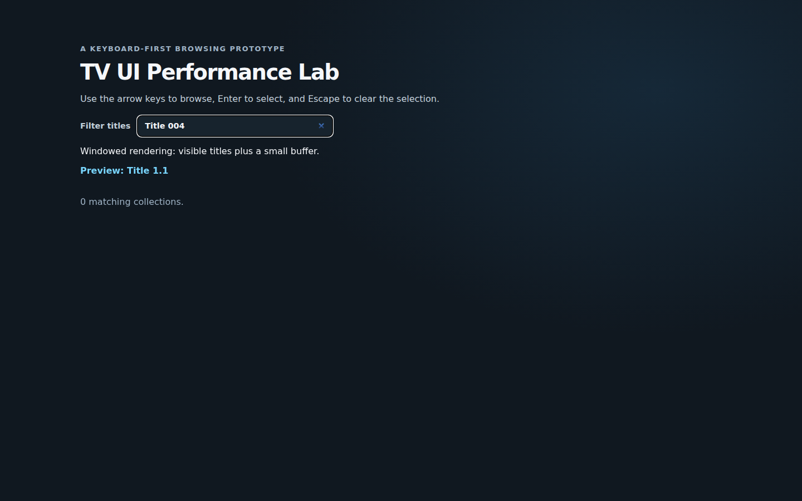

# TV UI Performance Lab

A portfolio-ready keyboard-first TV browsing prototype for measuring responsive
UI behavior under constrained conditions. The catalog is synthetic and uses
local placeholder posters, so the app has no external data or image dependency.

## Live demo

[https://tv-ui-perf-lab.vercel.app/](https://tv-ui-perf-lab.vercel.app/)

The repository is Vercel-ready through `vercel.json`, and CI validates pushes
and pull requests through [GitHub Actions](https://github.com/sumitjangid/TV-UI-Perf-Lab/actions/workflows/ci.yml).

## Demo

<video src="public/demo.webm" controls muted width="720">
  <a href="public/demo.webm">Watch the short TV UI demo</a>
</video>


The catalog supports keyboard-first browsing and a title filter that runs in a
dedicated Web Worker. The filter keeps catalog processing off the main thread
and is useful for explaining browser responsiveness and worker boundaries:



## Getting started

```bash
npm ci
npm run generate:catalog
npm run dev
```

Open the local URL printed by Vite. The catalog generator creates 40
collections with 250 synthetic titles each and uses a local placeholder image,
so no external image service or API key is needed.

## Status

Milestone 9: deployment configuration and project polish are implemented.

## Guides

- [Learning guide](docs/learning-guide.md): what each milestone builds and why.
- [Interview guide](docs/interview-guide.md): practice questions and ways to
  explain the decisions.
- [Architecture guide](docs/architecture.md): how the app is structured today
  and how it is expected to grow.
- [Design system guide](docs/design-system.md): current visual styles and the
  principles for extending them.
- [Demo script](docs/demo-script.md): a short walkthrough of the finished
  project.

## Checks

```bash
npm run generate:catalog
npm test
npm run lint
npm run build
npm run analyze:experiment
npm run test:e2e
npm run bench:check
```

## Validate A/B variants locally

1. Start the app with `npm run dev` and open the local URL.
2. Open browser DevTools, then **Application > Local Storage**.
3. Set a known anonymous ID and reload:

   ```js
   localStorage.setItem("tv-perf-lab-anon-id", "qa-visitor-a");
   location.reload();
   ```

4. Inspect the `<main>` element in **Elements**:
   - `tile-size-standard` or `tile-size-large`
   - `data-preview-delay="preview-400"` or `data-preview-delay="preview-1200"`
5. Wait for the focus preview, or move focus with the arrow keys.
6. Press Enter or click a tile to record a selection.
7. Inspect `tv-perf-lab-experiment-events` in Local Storage. Each entry
   identifies the visitor, experiment, variant, event type, and timestamp.

Use different `tv-perf-lab-anon-id` values to inspect different assignments.
The same ID remains assigned to the same variants after a reload. Clearing
both local-storage keys starts a clean local test.

## Benchmark

Install Chromium once with `npx playwright install chromium`, then run
`npm run bench` to compare windowed and naive rendering under CPU throttling.
On Linux, if Chromium reports missing shared libraries, install them with
`npx playwright install-deps chromium`.

## Architecture

- **Catalog generation:** a Node script creates 40 rows and 250 synthetic
  titles per row.
- **State:** Redux Toolkit stores the active row, column, row lengths, and
  each row's remembered position.
- **Navigation:** the remote-key hook dispatches movement actions; window helpers
  decide which rows and cards remain mounted.
- **Comparison:** `?mode=naive` disables windowing for benchmark comparison.
- **Experiments:** hash bucketing creates sticky local assignments, and local
  storage receives exposure and selection events.
- **Quality:** Node tests cover focus/range/statistics logic, Playwright and axe
  cover keyboard/accessibility behavior, and GitHub Actions run a benchmark
  performance budget.

See [the architecture guide](docs/architecture.md) for the full flow.

## Reference benchmark

Reference values from a Codespace run using Chromium 1920 × 1080, with three
repetitions per scenario:

| Mode | CPU | Load (ms) | Key p50/p95 (ms) | Long tasks | Heap (MB) | DOM nodes |
|---|---:|---:|---:|---:|---:|---:|
| Windowed | 1x | 195.1 | 33.4 / 62.1 | 0 | 5.0 | 214 |
| Windowed | 4x | 605.9 | 36.1 / 81.1 | 2 | 5.0 | 214 |
| Windowed | 6x | 735.7 | 36.2 / 76.8 | 4 | 5.0 | 214 |
| Naive | 1x | 1,146.3 | 70.2 / 138.9 | 19 | 29.4 | 30,138 |
| Naive | 4x | 4,417.1 | 281.1 / 417.4 | 34 | 41.9 | 30,138 |
| Naive | 6x | 6,557.1 | 402.2 / 620.5 | 35 | 39.1 | 30,138 |

These values are environment-specific observations, not portable guarantees.
The benchmark measures browser-side key-to-two-frame latency, not physical
remote-to-screen latency.

## Windowed vs. naive comparison

| Scenario | Mounted DOM nodes | 4× key p95 | 4× long tasks | 4× JS heap |
|---|---:|---:|---:|---:|
| Windowed | 214 | 81.1 ms | 2 | 5.0 MB |
| Naive | 30,138 | 417.4 ms | 34 | 41.9 MB |

The windowed implementation reduces mounted DOM nodes by about 99.3% and
4×-CPU key latency p95 by about 80.6% in the recorded Codespace run. These
numbers are repeatable local evidence, not universal TV-device guarantees.

## Live Lighthouse and Core Web Vitals

Measured against the deployed Vercel URL on November 23, 2026:

| Lighthouse category | Score |
|---|---:|
| Performance | 91 |
| Accessibility | 100 |
| Best Practices | 100 |
| SEO | 92 |

| Core Web Vital / metric | Result |
|---|---:|
| First Contentful Paint | 0.8 s |
| Largest Contentful Paint | 1.5 s |
| Cumulative Layout Shift | 0.028 |
| Total Blocking Time | 370 ms |
| Speed Index | 1.4 s |

The raw Lighthouse report is retained at
[lighthouse/live.json](lighthouse/live.json). Regenerate it with:

```bash
npm run lighthouse:deployed
```

## A/B framework

The app demonstrates:

- Standard versus large title cards.
- A 400 ms versus 1200 ms focused-title preview delay.

The browser stores a stable anonymous ID and experiment events locally.
`npm run analyze:experiment` prints explicitly labeled synthetic results.
Synthetic conversion lift is not real customer evidence.

## Accessibility

The app includes a skip link, visible focus ring, list and heading semantics,
accessible title names, live focus announcements, and reduced-motion handling.
The Playwright/axe suite checks detectable violations and keyboard behavior,
but does not replace screen-reader and visual testing.

## Limitations

- Synthetic catalog data and placeholder posters are not production content.
- Desktop Chromium CPU throttling approximates constrained devices; it is not
  real TV hardware.
- Browser heap and timing values vary between machines and runs.
- Local events are not sent to a server and should not be used as real telemetry.
- Automated accessibility checks cannot catch every user-experience issue.

## What I would do next

- Test on real TV hardware and physical remotes.
- Use real title images with modern formats and image fallbacks.
- Move larger data preparation into a Web Worker or a server-side API.
- Send privacy-aware production telemetry to a real experiment backend.
- Establish persistent benchmark history and compare pull requests by relative
  regression rather than fixed machine-dependent values.

## Deploy to Vercel

The included `vercel.json` uses Vite's production build and serves `dist`.

1. Push the repository to GitHub.
2. Import the repository in Vercel.
3. Keep the framework preset as Vite.
4. Use `npm run build` as the build command and `dist` as the output directory,
   or import the checked-in `vercel.json` configuration.
5. Deploy and add the live URL to the README.

## Credits

- React, Redux Toolkit, Vite, TypeScript, Playwright, axe-core, and oxlint.
- A local SVG placeholder poster is used instead of third-party image services.
