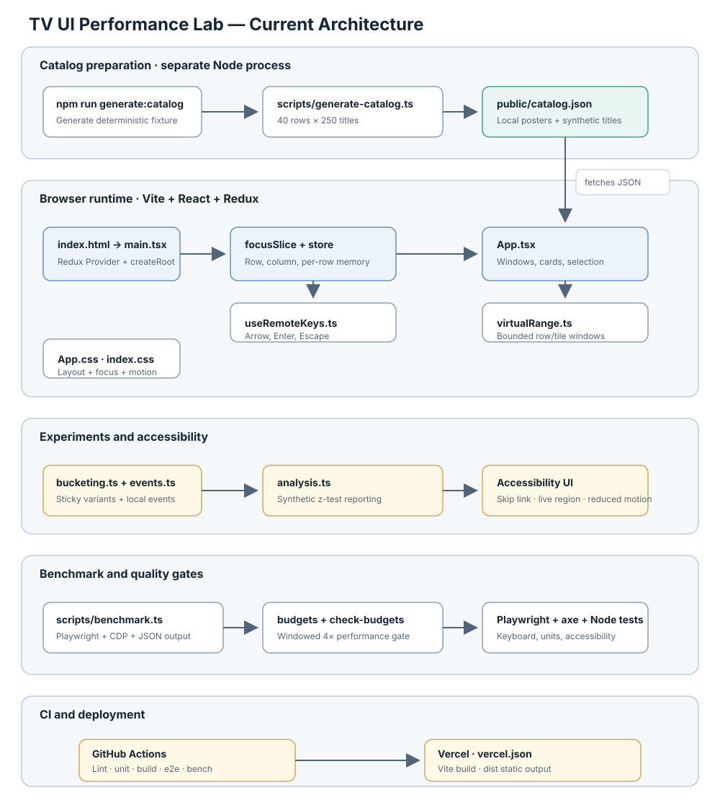
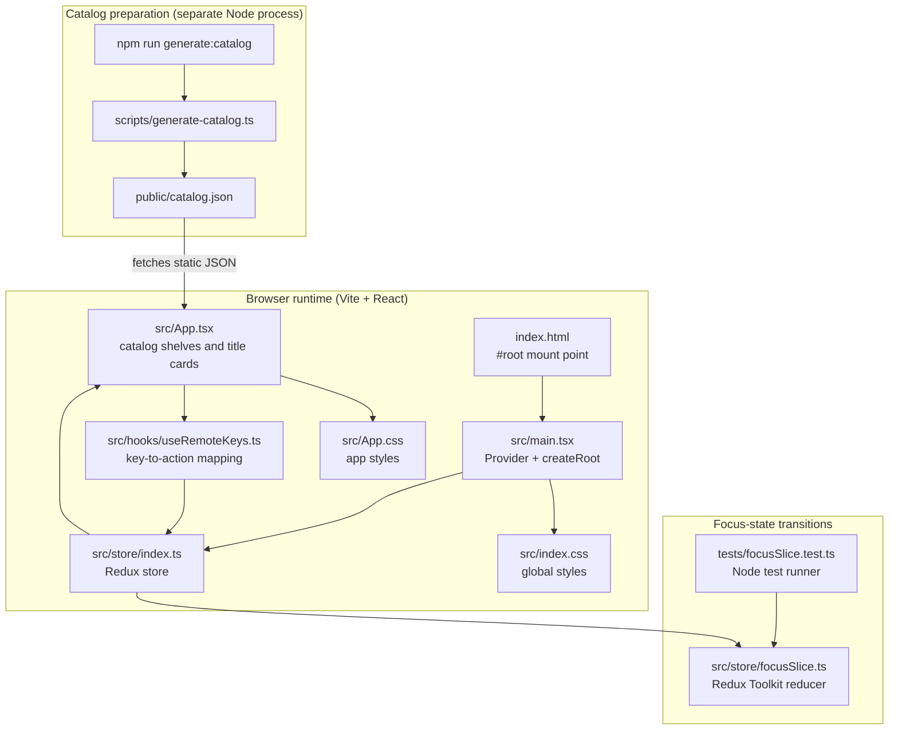

# Architecture Guide

This guide describes the architecture that exists in the repository now,
separates it from the longer-term plan, and explains why the boundaries matter.
The [project plan](../TV_UI_Perf_Lab.md) is a roadmap, not a description of
features already implemented.

## Current architecture

### Rendered diagram

### Mermaid source

The catalog-generation and browser-runtime flows are separate. The browser
fetches the generated static JSON; the data is not bundled into the app's
JavaScript.

- The **generator** creates a predictable data fixture in `public/`.
- The **React app** loads and validates the catalog, then renders shelves and
  title cards.
- The **key hook** translates keyboard events to Redux actions. The reducer
  owns navigation transitions, while the app renders the focused position.

## Responsibilities of the current files

| File | Responsibility |
|---|---|
| `index.html` | Provides the document and the `#root` mount point. |
| `src/main.tsx` | Creates the store, wraps the app in `Provider`, imports global CSS, and mounts `App` inside `StrictMode`. |
| `src/App.tsx` | Loads and validates the catalog, renders shelves, and synchronizes visible focus and selection. |
| `src/index.css` | Sets global typography, page defaults, colors, and box sizing. |
| `src/App.css` | Styles the app shell, shelves, title cards, and focused state. |
| `scripts/generate-catalog.ts` | Generates 40 rows with 250 synthetic titles per row and writes the JSON fixture. |
| `public/catalog.json` | Stores the generated fixture as a static asset fetched by the browser. |
| `public/posters/poster-placeholder.svg` | Supplies a local image asset without an external request. |
| `src/store/focusSlice.ts` | Defines focus-state transitions and navigation actions. |
| `src/store/index.ts` | Configures the Redux store used by the React Provider. |
| `src/hooks/useRemoteKeys.ts` | Maps arrow, Enter, and Back/Escape key events to navigation behavior. |
| `tests/focusSlice.test.ts` | Tests focus movement rules using Node's built-in test runner. |
| `vite.config.ts` | Configures the Vite + React development and build toolchain. |

### Browser startup, step by step

1. The browser loads `index.html`, which contains the root DOM element.
2. Vite resolves the module entry at `src/main.tsx`.
3. `main.tsx` creates the Redux store, wraps the app in `Provider`, and calls
   `createRoot` to attach React to the root element.
4. `App` fetches `/catalog.json`, validates the response, and initializes row
   lengths in the focus reducer.
5. React renders the shelves and title cards; the key hook dispatches
   navigation actions and the selected card is brought into view.
6. The CSS files apply global defaults and component-level presentation.

`StrictMode` is a development aid that helps reveal certain unsafe patterns. It
does not add an application state layer or a production UI feature.

## Catalog data flow

Run `npm run generate:catalog` to execute the TypeScript generator through
`tsx`. The generator derives the output path from its own file location rather
than assuming the command was started from a particular working directory.
It creates stable IDs (`row-<row index>` and `t-<row index>-<item index>`),
human-readable synthetic titles, and a local placeholder image path.

Keeping generation separate from browser rendering has useful properties:

- **Repeatability:** the same constants produce the same shape and IDs on each
  run.
- **Control:** the number of rows and items can be adjusted to create
  comparable workloads.
- **Isolation:** data preparation does not need a live service, credentials,
  or network access.
- **Honest scope:** a large fixture is not itself a performance result. The UI
  must consume it and be measured before we can draw conclusions about
  rendering.

The generator writes a complete JSON file into `public/`, and the browser
fetches it as a separate asset. The response shape is checked at the boundary
before the data is passed to the rendering logic.

## Build and quality boundary

- **Vite** serves the app during development and bundles the browser code for
  production.
- **TypeScript** checks the application and build configuration.
- **Oxlint** checks the source with the repository's configured rules.
- **Node's built-in test runner**, launched through `tsx`, tests the focus
  reducer without adding a separate test framework.
- **The generator** is a separate Node-side script. The generated catalog is
  served as static JSON, not embedded in the application JavaScript.

The current validation commands are `npm test`, `npm run lint`, and
`npm run build`. Building successfully confirms the current TypeScript and
bundling pipeline; it does not measure runtime scrolling performance.

## How the architecture should grow

The roadmap describes a TV browsing interface with keyboard navigation,
focus state, large lists, and performance measurement. A sensible direction
is to preserve clear boundaries as those features arrive:

1. **Data boundary:** model catalog rows and items with explicit TypeScript
   types. Keep generated or fetched data separate from presentation.
2. **Presentation components:** compose the screen from focused pieces such as
   a page, a shelf/row, and a title card. Give each component the data and
   state it needs through props.
3. **Interaction boundary:** keep remote-key interpretation out of visual
   components. Translate key events into named navigation actions, then
   update one explicit focus model.
4. **Rendering boundary:** make a straightforward implementation first.
   Introduce windowing or image-loading optimizations only when the benchmark
   shows a measurable bottleneck.
5. **Measurement boundary:** keep performance instrumentation and benchmark
   output separate from product UI logic so results can be repeated and
   compared.

The current UI uses Redux Toolkit for shared focus state. Additional
application state should be added only when a later milestone needs it.

## Why these boundaries help

- **Independent reasoning:** the generator, UI, and measurement code solve
  different problems and can be changed without entangling every file.
- **Testability:** pure navigation and range calculations can be tested
  without rendering the entire application.
- **Performance diagnosis:** separating data work, state updates, and rendering
  makes it easier to find which layer causes slow interactions.
- **Incremental delivery:** each milestone can add one capability while
  keeping the app runnable and its current behavior understandable.
